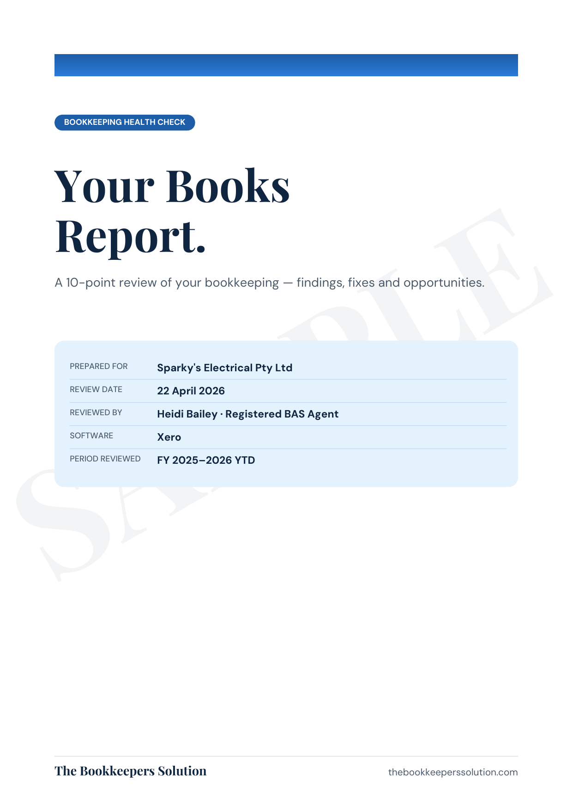

  <a href="https://book.stripe.com/9B67sEf137sw53m54D8k800" class="btn btn-primary btn-lg">Book My $49 Health Check</a>
  <a href="#sample" class="btn btn-outline btn-lg">See a Sample Report</a>
  
Secure Stripe payment · No lock-in · No ongoing bookkeeping commitment

## What we check

  
01<h3>Bank reconciliations</h3>
Whether your bank accounts are up to date and whether unreconciled items are hiding errors.

  
02<h3>Unreconciled transactions</h3>
Old, duplicated or unusual transactions that deserve a closer look.

  
03<h3>GST &amp; BAS coding</h3>
Obvious coding issues and transactions that may affect your BAS reporting.

  
04<h3>Aged debtors</h3>
Customers who owe you money, old balances and potential collection issues.

  
05<h3>Aged creditors</h3>
Old supplier balances, duplicates and amounts that may no longer be correct.

  
06<h3>Balance sheet accounts</h3>
Unusual or stale balances that may need reconciliation or investigation.

  
07<h3>Payroll &amp; super</h3>
High-level checks for balances or reporting that warrant further attention.

  
08<h3>Duplicates &amp; anomalies</h3>
Transactions and balances that look out of place and may need cleaning up.

## What you get

  
<h3>A simple health report</h3>
A clear traffic-light view of what's healthy, what needs watching and what needs attention.

  
<h3>Practical recommendations</h3>
We'll tell you the most important things to address first, without drowning you in accounting jargon.

  
<h3>A clean next step</h3>
You can fix the issues yourself, take the report to your current bookkeeper, or ask us to quote for the clean-up.

  
<h3>No ongoing commitment</h3>
The $49 Health Check stands on its own. There is no requirement to move your bookkeeping to us.

  

    <h2 style="border:none; padding:0; margin-top:0;">See what a report looks like</h2>
    
Have a look at our sample report so you can see the style of feedback you'll receive.

    <a href="/assets/sample-health-check-report.pdf" class="btn btn-primary" target="_blank" rel="noopener">Download Sample Report (PDF)</a>
  

  

## Who this is for

  
<h3>A great fit if</h3><ul><li>You're an Australian small business</li><li>You use Xero, MYOB or QuickBooks</li><li>You aren't quite sure whether your books are actually right</li><li>You want an independent second pair of eyes</li><li>You want to know what should be fixed first</li></ul>

  
<h3>Maybe not right if</h3><ul><li>You need a full audit or assurance engagement</li><li>You need tax or financial advice</li><li>Your bookkeeping hasn't yet been entered into accounting software</li><li>You need a large historical catch-up completed immediately</li></ul>

<h2 id="book">Book your $49 Health Check</h2>

  
<strong>This week only:</strong> secure your Bookkeeping Health Check for $49.

  
Stripe will collect your name, business name, email, phone number, accounting software and what you'd most like us to check. After payment we'll give you the next steps for securely granting access to your accounting file.

  
<strong>Never send us your Xero, MYOB or QuickBooks password.</strong> Access should always be granted through the software's own user or adviser invitation process.

  <a href="https://book.stripe.com/9B67sEf137sw53m54D8k800" class="btn btn-primary btn-lg">Pay $49 &amp; Book My Health Check</a>
  
Secure payment is handled by Stripe. No subscription and no ongoing bookkeeping commitment.

## Common questions

  

What happens after I pay?

We'll confirm the next steps and show you how to securely invite The Bookkeepers Solution to your Xero, MYOB or QuickBooks file. You should never send us your accounting software password.

  

What access do you need?

Only the access reasonably required to review the areas included in your Health Check. We'll provide platform-specific instructions for granting access, and you can remove our access afterwards.

  

Is this an audit or tax review?

No. This is a focused, high-level bookkeeping review. It is not an audit, assurance engagement, tax advice or financial advice, and it cannot guarantee that every error or compliance issue will be identified.

  

Do I have to sign up for ongoing bookkeeping?

No. If the review identifies work that needs fixing, you can deal with it yourself, take the report to your existing bookkeeper, or ask us for a separate quote.

  

Which software do you support?

The offer is designed for Australian small businesses using Xero, MYOB or QuickBooks.

  <h2 style="border:none; padding:0; margin:0 0 0.5rem;">Not quite sure your books are as healthy as they look?</h2>
  
Get a fresh pair of bookkeeping eyes over them for $49 this week.

  <a href="https://book.stripe.com/9B67sEf137sw53m54D8k800" class="btn btn-white btn-lg">Book My $49 Health Check</a>

